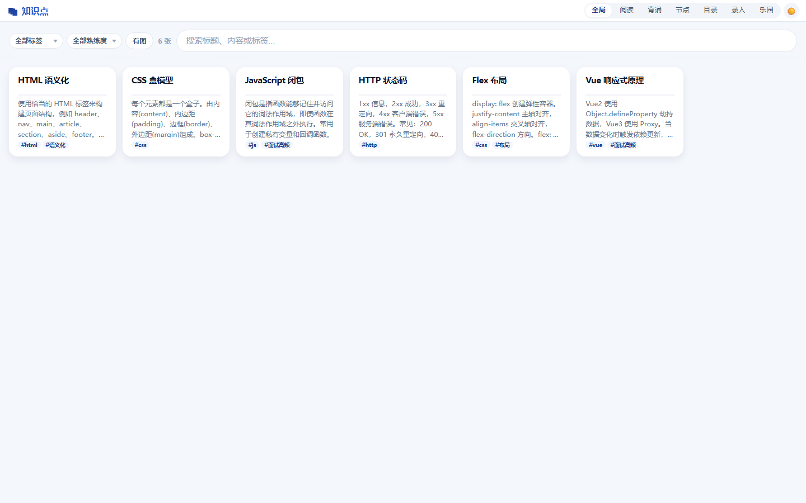
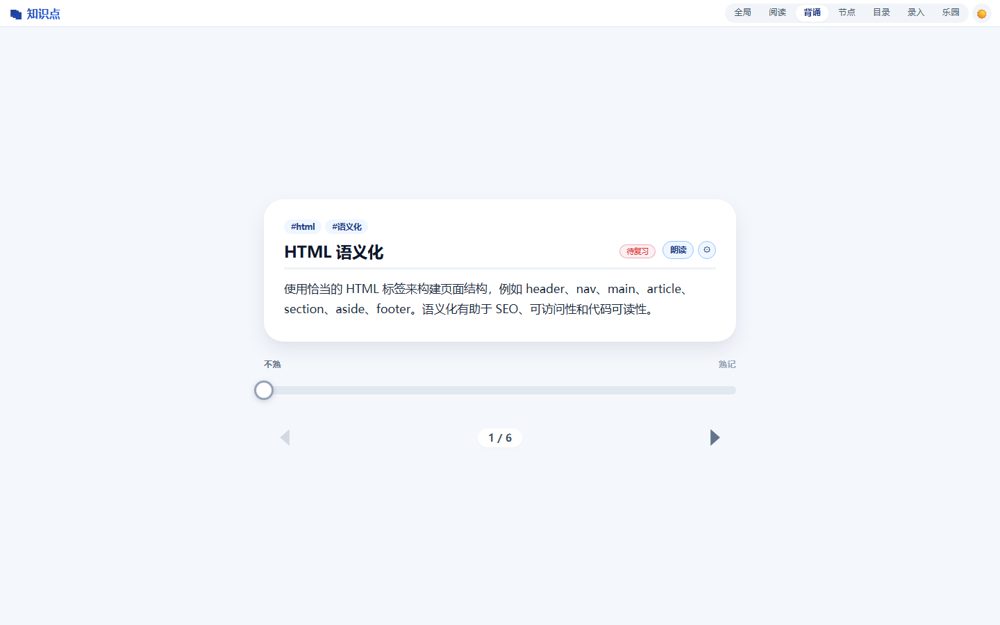
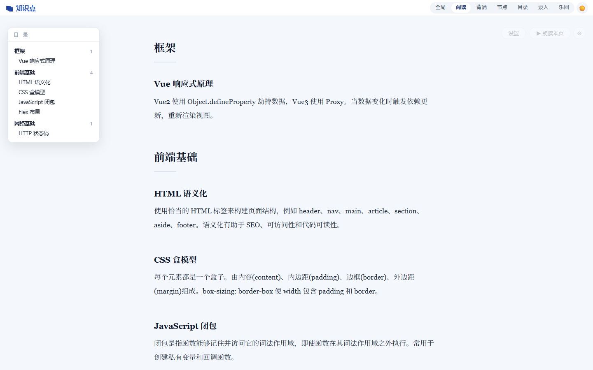
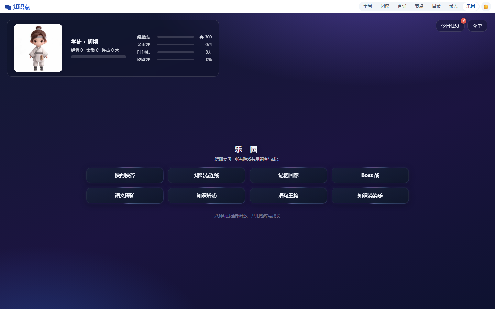
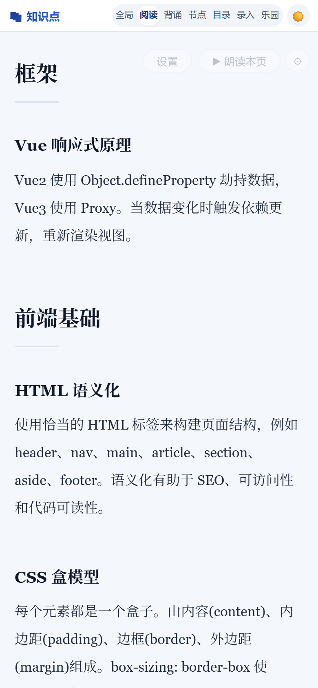
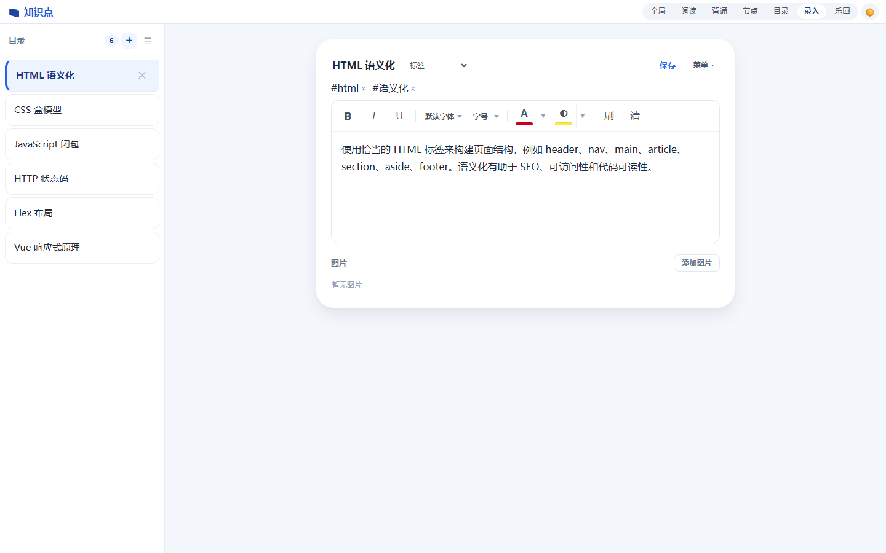
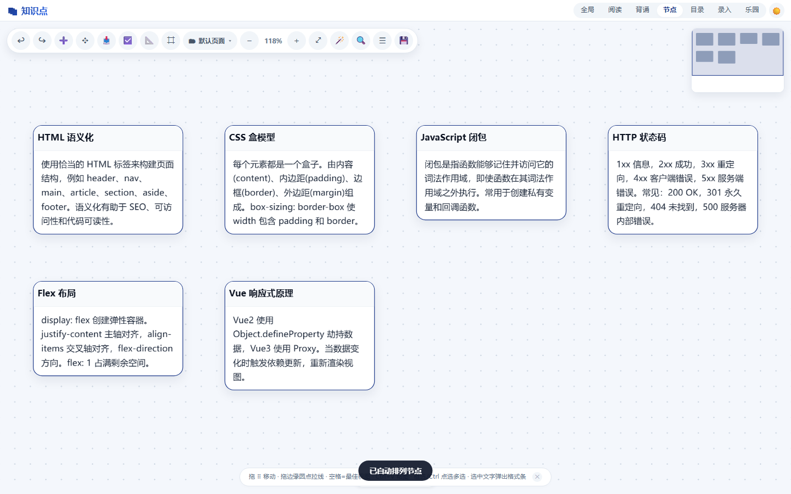
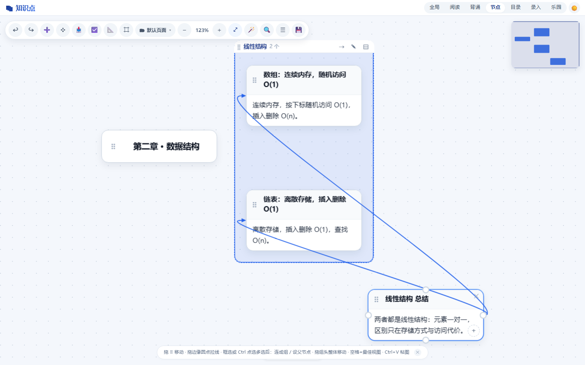
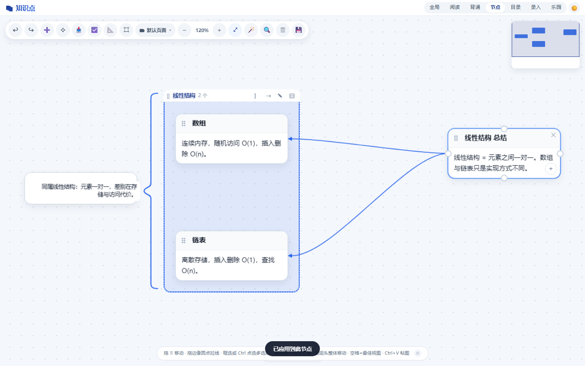

[README.md](https://github.com/user-attachments/files/34212945/README.md)
# 知识点记忆卡片

一个**单文件、离线、无需账号**的知识点记忆工具。所有代码都在 `index.html` 里，双击就能用；数据存在你自己的浏览器里，不上传任何服务器。

当前版本：`2026-10-31g`（版本号写在 `index.html` 内的 `window.__KV__`）



---

## 1. 这个项目解决什么问题

背知识点这件事，卡人的往往不是"没时间看"，而是下面这几件：

| 痛点 | 本项目的做法 |
|---|---|
| 内容散在笔记、文档、截图里，找不到、翻不动 | 统一录入成卡片，按**目录 + 标签**组织，全局搜索标题/内容/标签 |
| 看一遍觉得记住了，合上书就忘 | 背诵模式先回忆再看答案（主动回忆），不是反复阅读 |
| 复习没有节奏，全凭感觉 | 按掌握度自动排**复习间隔**（1/2/3/7/15/30 天），到期的排在前面 |
| 复习枯燥，坚持不下来 | 乐园里有八款小游戏，用同一批知识点出题，答对答错都会回写掌握度 |
| 想要「能读给我听」，但不想装 App、不想注册 | 阅读模式支持整页朗读（系统音色离线可用，也可接 Azure 神经语音） |
| 用第三方笔记/背单词 App，数据不在自己手里 | 单 HTML 文件，数据全在本地浏览器，随时导出 JSON 完整备份 |

它**不做什么**：不提供云同步、不提供账号体系、不内置题库（自带 6 条示例，可随时删）。本质是"你自己的知识点 + 一套记忆机制"。

---

## 2. 主要功能

### 2.1 七种视图

顶栏七个模式，各有分工：

| 模式 | 用来做什么 | 关键操作 |
|---|---|---|
| **全局** | 总览所有知识点 | 卡片墙；按标签 / 掌握度 / 有无图片筛选；搜索框搜标题、内容、标签 |
| **阅读** | 当长文读 | 左侧目录跳转；顶栏「▶ 朗读本页」从当前位置读到本页最后一条，自动滚动，浮条可跳过 / 停止 |
| **背诵** | 逐张回忆自测 | 左右箭头翻卡；底部滑块自评掌握度（不忘 ↔ 牢记）；到期的知识点优先出现 |
| **节点** | 画知识关系图 | 画布多页面；新建节点或「📥 把知识点导入为节点」；拖端口连线；框选/Ctrl 多选后批量连线、批量设父节点、成组；从组头拉出总结节点（落点左右决定挂载 / 最短连线）；分组左/右/下三边可加大括号写总结；自动排列（自动选择 / 矩阵 / 组织结构 / 树形图）；导出图片 / PDF |
| **目录** | 管理结构与顺序 | 层级按钮逐层进入，双击卡片进入子目录；拖到卡片中间=设为子目录、拖到左右边缘=排前/排后；新建目录、按名称排序、撤销、全部展开 / 折叠、浮动模式批量整理 |
| **录入** | 写和改 | 标题、标签、富文本正文（粗体/斜体/下划线/字体/字号/颜色/高亮）、插入图片 |
| **乐园** | 玩着复习 | 八款游戏 + 经验/金币/境界/图鉴 + 每日任务 |

> 目录模式下排好的顺序，会同步到全局、背诵、阅读里，不会各排一套。

### 2.2 掌握度与间隔重复

- 每个知识点有一个 0~100 的**掌握度**，背诵时用滑块自评，乐园答题也会自动加减（答对 +2、答错 −1，可在游戏设置里关闭回写）。


- 掌握度决定下次复习时间：

  | 掌握度 | < 20 | ≥ 20 | ≥ 40 | ≥ 60 | ≥ 75 | ≥ 90 |
  |---|---|---|---|---|---|---|
  | 复习间隔 | 1 天 | 2 天 | 3 天 | 7 天 | 15 天 | 30 天 |

- 背诵模式按"是否到期"排序，到期的排最前，卡片上还有复习提醒角标。

### 2.3 朗读



- **整页朗读**：阅读模式顶栏「▶ 朗读本页」，从当前视口第一条一路读到最后一条，边读边滚动；浮条上有「跳过」「停止」。
- **单条朗读**：背诵卡片上有朗读按钮。
- **两条音路**（同一处理解，面板里一个下拉选完）：
  - **系统音色**：浏览器/系统自带的语音，离线可用，起播快。Windows 上有 Microsoft Huihui / Kangkang，macOS 上有 Tingting，手机上只有系统已装的离线音色。
  - **Azure 云端音色**：晓晓 / 云希等神经语音，更自然、起播最快，但需要联网 + 自己的 Azure 密钥（免费 F0 层每月 50 万字符）。
- 可调**语速**（0.75~1.2）、**句间停顿**（0~0.6s）；面板底部有「查看并复制诊断信息」，朗读出问题时可以导出状态排查。
- 技术上有几条硬约束（都是踩坑换来的）：整条知识点作为一次播放原子、不在队列里 cancel、只在停止/跳过时掐断、cancel 后隔一拍再发声。

### 2.4 数据导入导出

| 方向 | 格式 | 说明 |
|---|---|---|
| 导出 | **JSON 完整备份** | 知识点 + 节点画布 + 图片 + 主题，换设备可完整还原 |
| 导出 | **Markdown** | 按目录分组的纯文本，方便进 Git / 其他笔记软件 |
| 导出 | **HTML** | 静态卡片墙，可直接发给别人看 |
| 导出 | **备考卷** | 随机抽最多 12 题，题干是标题，点「显示答案」看内容，可打印 |
| 导出 | **Word (.docx)** | 可选范围：全部 / 当前 / 某个目录 / 某个标签 |
| 导出 | **节点图片 / PDF** | 可选纸张规格、横竖方向、分页 |
| 导入 | **JSON 数组** | 批量新增知识点，合并（追加）或覆盖（清空后替换） |
| 导入 | **CSV** | 适合从 Excel / 表格批量导入 |
| 导入 | **完整备份 JSON** | 识别备份对象后走"完整还原"（含节点画布与主题） |

### 2.5 乐园：八款游戏 + 成长体系



- **八款玩法**：快问快答、知识点连线、记忆回廊、Boss 战、语义探矿、知识塔防、语句重构、知识消消乐。题目全部由你自己的知识点即时生成，不需要单独维护题库。
- **四条成长线**：经验（决定境界与人物形象）、金币、连续天数、图鉴（全部知识点的平均掌握度）。
- **境界** 15 级：学徒 / 书童 / 学者 / 大师 / 守塔人，每级分初期、中期、后期（经验阈值 0 → 200000）。
- **联动**：答错的知识点进"错题回炉"队列（连对 2 次才出队）；一局结束有复盘卡；目录掌握度达标可领一次性阶梯奖励；每日任务 + 每日挑战。
- 键盘：`1`~`4` 直接选答案，`Esc` 暂停塔防。

### 2.6 界面与适配

- 5 种主题：浅色 / 深色 / 护眼 / 彩色 / 现代，另可跟随系统。
- 响应式：桌面双栏、手机单栏；手机可通过「添加到主屏幕」当 App 用（`index.html` 内已内嵌 web app manifest）。
- 全局撤销 / 重做：`Ctrl/Cmd + Z`、`Ctrl/Cmd + Y`；节点模式 `Ctrl/Cmd + Shift + L` 自动排列、`Ctrl/Cmd + F` 搜索节点。

<p align="center"></p>

---

## 3. 安装方法

**没有构建步骤，没有依赖，没有 `npm install`。** 一个 HTML 文件就是完整程序。

### 方式 A：直接打开（最快）

下载 `index.html`，双击用浏览器打开即可。推荐 Chrome / Edge / Safari 的较新版本。

### 方式 B：本地起一个静态服务（推荐，行为最接近线上）

```bash
# 在 index.html 所在目录执行任意一条
python -m http.server 8000
# 然后浏览器访问 http://localhost:8000/index.html
```

Cloud TTS（Azure 朗读）建议用这种方式或线上地址，避免个别浏览器对 `file://` 的跨域限制。

### 方式 C：部署到线上

`index.html` 是纯静态文件，丢到任意静态托管即可：GitHub Pages、Netlify、Vercel、对象存储、自己的 Nginx……不需要后端和数据库。

```bash
# 例：GitHub Pages，把 index.html 放到仓库根目录，Settings → Pages → 选择分支即可
```

### 手机上当 App 用

- **iOS Safari**：打开页面 → 分享 → 「添加到主屏幕」
- **Android Chrome**：菜单 → 「添加到主屏幕」/「安装应用」

添加后是全屏无地址栏的独立窗口。

### 可选：开启云端朗读（Azure 神经语音）

1. 在 Azure 门户创建「语音服务」资源，定价层选免费 **F0**
2. 进入应用 → 阅读模式顶栏齿轮 ⚙ → 找到「云端朗读」→ 开启
3. 选区域（国内推荐 `eastasia` 东亚-香港）、粘贴订阅密钥
4. 回到上方「音色」下拉，会多出一组「云端音色（Azure · 需联网）」，选中后点「▶ 试听当前音色」

密钥只存在你自己浏览器的 localStorage 里，不会上传到任何第三方（合成请求直接由浏览器发往 Azure）。

### 浏览器要求

| 能力 | 用途 | 缺少时的表现 |
|---|---|---|
| localStorage + IndexedDB | 保存知识点、图片 | 无法保存（现代浏览器默认都有） |
| SpeechSynthesis | 系统音色朗读 | 朗读按钮不可用，其余功能正常 |
| ES6+ / CSS 变量 | 整体运行 | 需要较新浏览器（Chrome/Edge 90+、Safari 15+） |

---

## 4. 使用方法

### 第 1 步：录入你的第一个知识点



1. 顶栏切到 **录入**
2. 点左侧目录区的 **＋** 新建知识点
3. 填 **标题**（背诵时它就是问题）、写 **正文**（支持富文本；可以直接粘贴截图）
4. 填 **标签**（回车确认）、设置所属 **目录**
5. 右上角点 **保存**

> 自带 6 条示例知识点（HTML 语义化、CSS 盒模型等），熟悉完可以在录入模式里删掉。

### 第 2 步：整理结构

切到 **目录** 模式：新建目录、把知识点拖到某个卡片**中间**就变成它的子目录，拖到**左右边缘**就是排到前面/后面。整理完的顺序全局通用。

### 第 3 步：背诵与自评

切到 **背诵** 模式：

1. 看卡片标题，先在脑子里回想
2. 拖动底部滑块：越靠左是「不忘」，越靠右是「牢记」
3. 用左右箭头切下一张

掌握度会被记下来，决定这张卡下次什么时候再出现。

### 第 4 步：听

切到 **阅读** 模式：

1. 左侧目录点一下跳到对应位置
2. 顶栏 **▶ 朗读本页** 开始朗读，页面会自动跟随滚动
3. 底部浮条可以 **跳过** 当前条、**停止** 整段
4. 想换声音 / 调语速：顶栏齿轮 ⚙ → 音色 / 语速 / 句间停顿（改完可以直接点「▶ 试听当前音色」）

### 第 5 步：画关系图（可选）



1. 切到 **节点** 模式
2. 点 **📥** 一句话把所有知识点导入为节点，或点 **➕** 新建空白节点
3. 从节点边缘的端口拖到另一个节点即可连线；选中连线后双击线上标签，可以写关系说明
4. 点 **🪄** 自动排列（自动选择 / 矩阵 / 组织结构 / 树形图）
5. 点 **💾** 导出图片或 PDF

#### 多选之后能做什么（批量栏）

在画布空白处拖出框选，或按住 `Ctrl`/`Cmd`（Mac）逐个点选，底部会出现批量栏：

| 按钮 | 效果 |
|---|---|
| **🔗 连线** | 选中里有**恰好一个标题节点**时，它以父节点身份和其余每个节点各连一条（放射状）；否则按选中顺序串成链。**父节点关系会同时建立**，不只是画条线 |
| **⬆ 设父节点** | 弹出节点列表，点谁谁就是父节点，选中的节点全挂到它下面。父节点本身也可以在选区里（同一批里挑一个当父） |
| **◉ 设父子 / ⊘ 取消父子** | 按选中顺序建立或取消父子关系 |
| **🗂 成组 / ⊞ 取消成组** | 把选中的节点框成一个可命名的分组（见下） |

#### 节点组



- **成组**：多选 → 批量栏 **🗂 成组**。默认名「分组 N」，双击组名或点组头 **✎** 改名。
- **相对位置固定、整体移动**：拖组头 ⣿ 或拖组内任意一个节点，整组一起走；组内间距不会被拖散。想单独挪某一个节点，按住 `Alt` 再拖。
- **组框自动贴合**：框的位置由成员包围盒实时算出，删成员、拖动、自动排列之后框都会自动收缩/跟随（自动排列也会保住组内相对位置）。
- **拉出总结节点**：按住组头的 **⇢** 拖到画布空白处松手，会生成「×× 总结」节点。**松手的位置决定怎么连线**：
  - 落在组**左边** → 沿用原来的父子关系：总结当父节点，组内顶层成员挂到它下面（总结在上、成员在下）。
  - 落在组**右边 / 上边 / 下边** → 走**最短连线**：两端各取离对方最近的那个连接点（比如总结在右边，就从总结的左边连到成员的右边），不再固定用「右→左」。
- **大括号说明**：组头 **｝** → 选「左边 / 右边 / 下边」，会在组框那一侧生成一个花括号，括号外侧直接写一句总结（点文字即可编辑，`Enter` 保存、`Shift+Enter` 换行、`Esc` 取消）。三条边可以同时有；再点一次已有的那条即移除。括号和文字都跟着组走，也会随页面保存。
- **取消成组**：组头 **⊟**，或选中组内节点后点批量栏 **⊞ 取消成组**。节点全部保留，只是不再成组。
- 分组会跟页面一起保存、随「备份 / 导出」一起走（JSON 里是 `nodeGroups` 页面的 `groups` 字段，含 `braces` 里的说明文字）。



### 第 6 步：玩着复习

切到 **乐园**：

- 八款游戏随便点，题目来自你的知识点
- 右上「今日任务」看每日目标，「菜单」看商店 / 设置 / 图鉴
- 答错的知识点会自动进入错题回炉

### 第 7 步：备份（重要）

**数据只存在当前浏览器里**，清缓存、换浏览器、换设备都会丢。请定期：

1. 切到 **录入** 模式，点右上 **菜单**
2. 点 **导出** → **💾 下载 JSON**（得到 `知识点备份_YYYYMMDD_HHMMSS.json`）
3. 换设备后：同一个菜单里点 **导入** → 粘贴/选择这个文件 → 会自动走"完整还原"

> 也可以只导出一部分：菜单里还有「导出 Word」，可按全部 / 当前 / 目录 / 标签四处范围挑。

---

## 5. 输入输出示例

### 5.1 输入：JSON 数组（批量新增）

导入弹窗里粘贴，选「合并」或「覆盖」。

最小可用（只有标题）：

```json
[
  { "title": "HTTP 状态码" },
  { "title": "TCP 三次握手" }
]
```

带完整字段：

```json
[
  {
    "title": "HTTP 状态码",
    "content": "1xx 信息，2xx 成功，3xx 重定向，4xx 客户端错误，5xx 服务端错误。常见：200 OK、301 永久重定向、404 未找到、500 服务器内部错误。",
    "group": "网络基础",
    "tags": ["http", "状态码"],
    "masteryLevel": 0,
    "images": [],
    "hidden": false
  }
]
```

字段说明：

| 字段 | 类型 | 说明 |
|---|---|---|
| `title` | string | **必填**，没有标题的记录会被跳过 |
| `content` | string | 正文，纯文本或 HTML 片段都行 |
| `group` | string | 所属目录名，不存在会自动建 |
| `tags` | string[] | 标签，每条最多 20 个 |
| `masteryLevel` | number | 0~100，省略按 0 处理 |
| `images` | string[] | 图片（data URL 或已有图片 id），一般留空 |
| `hidden` | boolean | 隐藏的知识点不参与浏览与背诵 |
| `id` | string | 可省略，省略时自动生成 |

### 5.2 输入：CSV（从 Excel 导入）

首行是表头，支持中英文列名：

```csv
标题,内容,目录,标签
HTTP 状态码,1xx 信息 2xx 成功 3xx 重定向 4xx 客户端错误,网络基础,http|状态码
TCP 三次握手,SYN → SYN+ACK → ACK,网络基础,tcp|握手
```

- 列名可用：`标题`/`title`/`题目`、`内容`/`content`、`目录`/`group`/`分类`、`标签`/`tags`
- 标签用 `|` 或 `;` 分隔
- 注意：CSV 解析是**按英文逗号切分**的，正文里请用中文逗号，否则会被切成两列

### 5.3 输出：JSON 完整备份

「导出」→「💾 下载 JSON」得到（节选）：

```json
{
  "app": "knowledge-cards",
  "version": 2,
  "time": "2026-10-31T08:12:00.000Z",
  "data": {
    "items": [
      {
        "id": "k-1a2b3c",
        "title": "HTML 语义化",
        "content": "<div>使用恰当的 HTML 标签来构建页面结构……</div>",
        "group": "前端基础",
        "tags": ["html", "语义化"],
        "masteryLevel": 40,
        "images": [],
        "hidden": false,
        "review": { "ts": 1793000000000, "level": 40, "intervalDays": 3, "due": 1793259200000 }
      }
    ],
    "nodePages": [
      { "id": "page-1", "name": "页面 1", "nodes": [], "edges": [],
        "groups": [{
          "id": "g-1", "name": "线性结构", "nodeIds": ["n-1", "n-2"],
          "braces": { "left": { "text": "同属线性结构，差别在存储与访问代价" } }
        }],
        "view": null, "collapsed": [] }
    ],
    "currentId": "page-1",
    "collapsedGroups": [],
    "theme": "auto",
    "hint": false,
    "pad": false
  }
}
```

把整个文件粘回「导入」，会识别为完整备份并提示还原（含节点画布与主题）。

### 5.4 输出：Markdown

```markdown
# 知识点记忆卡片

## 前端基础

### HTML 语义化
`html`, `语义化`

使用恰当的 HTML 标签来构建页面结构，例如 header、nav、main、article……

---
```

按目录分组，标签用行内代码，正文转纯文本，条目之间用 `---` 分隔。

### 5.5 输出：备考卷

随机抽最多 12 个知识点生成的 HTML 试卷：题干是标题，答案默认折叠，点「显示答案」展开自测，可直接打印或用浏览器存 PDF。

### 5.6 输出：节点图

节点模式的「💾 导出」可输出 PNG 或 PDF，支持选纸张规格（A4 等）、横竖方向与自动分页。

---

## 6. 目录结构

```
知识点卡片开发/
├─ index.html              ← 程序本体（唯一交付物，约 1.6MB，含内嵌图片）
├─ README.md               ← 本文档
├─ LICENSE                 ← GNU GPL v3 全文（官方原版，未改动）
├─ backups/                ← 历史版本备份 index_backup_<版本>.html
├─ docs/
│   ├─ images/             ← README 截图
│   ├─ 开发迭代记录.txt      ← 逐条问题与修复记录
│   └─ *.md                ← 各模块设计方案
├─ patches/                ← 一次性补丁生成脚本（历史记录，一般只读）
├─ tests/                  ← 回归脚本（Playwright）
└─ assets/素材/            ← 原始立绘与图标（页面不引用，运行时不需要）
```

> **部署只需要 `index.html` 一个文件**。其余目录是开发资料，上线时可以不带。
> 页面内的图标、立绘、manifest 全部以 base64 内嵌，因此不会产生任何外部资源请求。

## 7. 开发与回归

```bash
python tests/_check.py        # 语法检查（提取内联脚本交 node --check）
python tests/_t_p20.py        # 单独跑某组回归
python tests/_t_smoke.py      # 七模式冒烟
```

回归脚本用 Playwright，桌面 1440×900 / 手机 390×844 双端跑，语音相关用例会 mock `speechSynthesis` 与 `Audio`。

## 8. 已知限制

- **数据在浏览器本地**：换浏览器、清站点数据、换设备都需要先导出再导入，没有云端同步。
- **iOS 网页朗读只能用离线音色**：系统里下载的「增强/优质」音色只给系统朗读用，网页接口拿不到（平台限制）。想要自然音色请用云端朗读。
- **云端朗读需要自备密钥**：密钥存在 localStorage，属于个人使用场景；若要公开发布，需要换成你自己的后端转发。
- **单文件体积约 1.6MB**：因为图片全部内嵌。离线可用、无外部请求，代价是首次解析稍慢。

## 9. 许可

本项目以 **GNU General Public License v3.0**（GPL-3.0）发布，许可证全文见根目录 [`LICENSE`](LICENSE)（FSF 官方原文，未作任何改动）。

```
Copyright (C) 2026 本项目作者

This program is free software: you can redistribute it and/or modify
it under the terms of the GNU General Public License as published by
the Free Software Foundation, either version 3 of the License, or
(at your option) any later version.
```

### 你可以

- 自由使用、修改、分发，**包括商业用途**（GPLv3 不禁止收费）。
- 复制、改编、再发布，无需事先联系作者。

### 你必须

- **分发时附带源码**：把这个 `index.html`（可读的源码）一并给出，或提供获取方式。
- **同样以 GPLv3 授权**：你分发出去的任何修改版，整体都必须继续以 GPLv3 开源（copyleft），不能改成闭源。
- **保留声明**：不得删除或修改版权声明、许可证声明与免责声明。
- **标明改动**：修改过的版本要在文件里注明"已修改"及修改日期。

### 免责与例外

- 本程序**不提供任何担保**，包括但不限于适销性与特定用途适用性（见 LICENSE 第 15、16 条）。
- 若你需要把这个项目**闭源嵌入**商业产品或私有系统，GPLv3 不允许，需要另行向作者取得授权。
- 第三方依赖（浏览器内置 API、可选的 Azure 语音服务）各自遵循其自身条款；`index.html` 不打包任何第三方代码，Azure 密钥由使用者自备。
